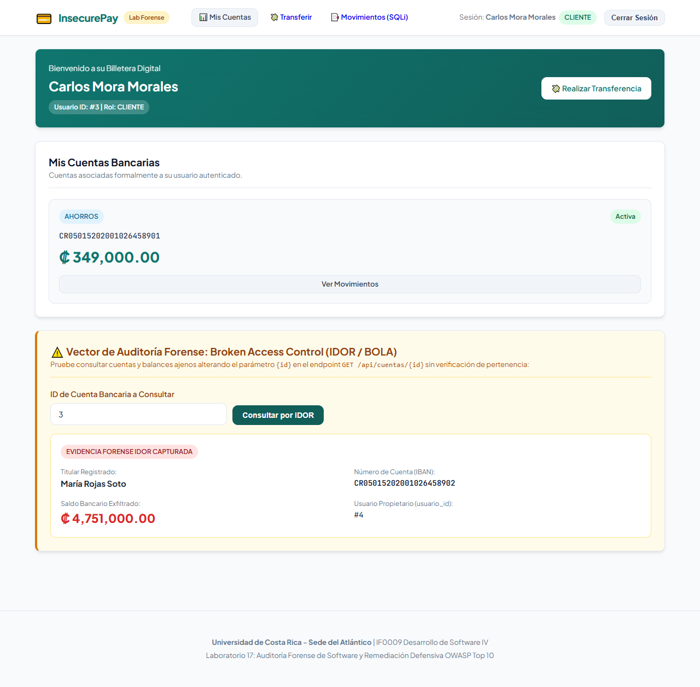
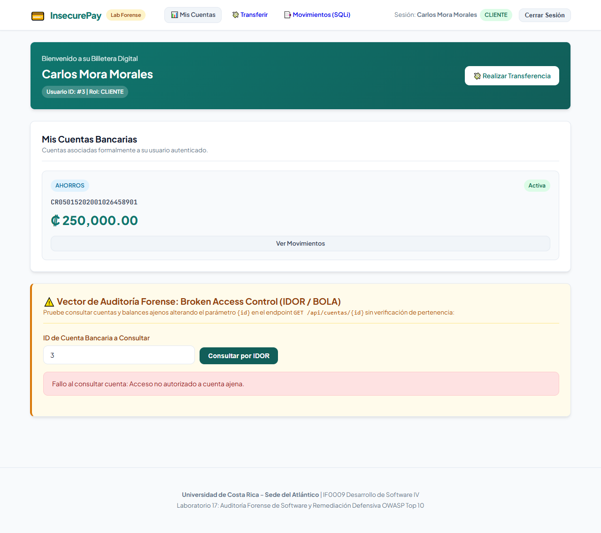
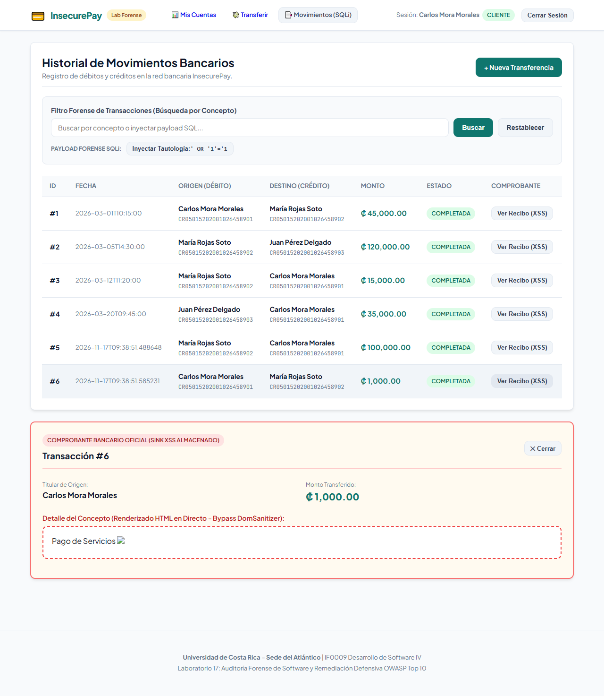
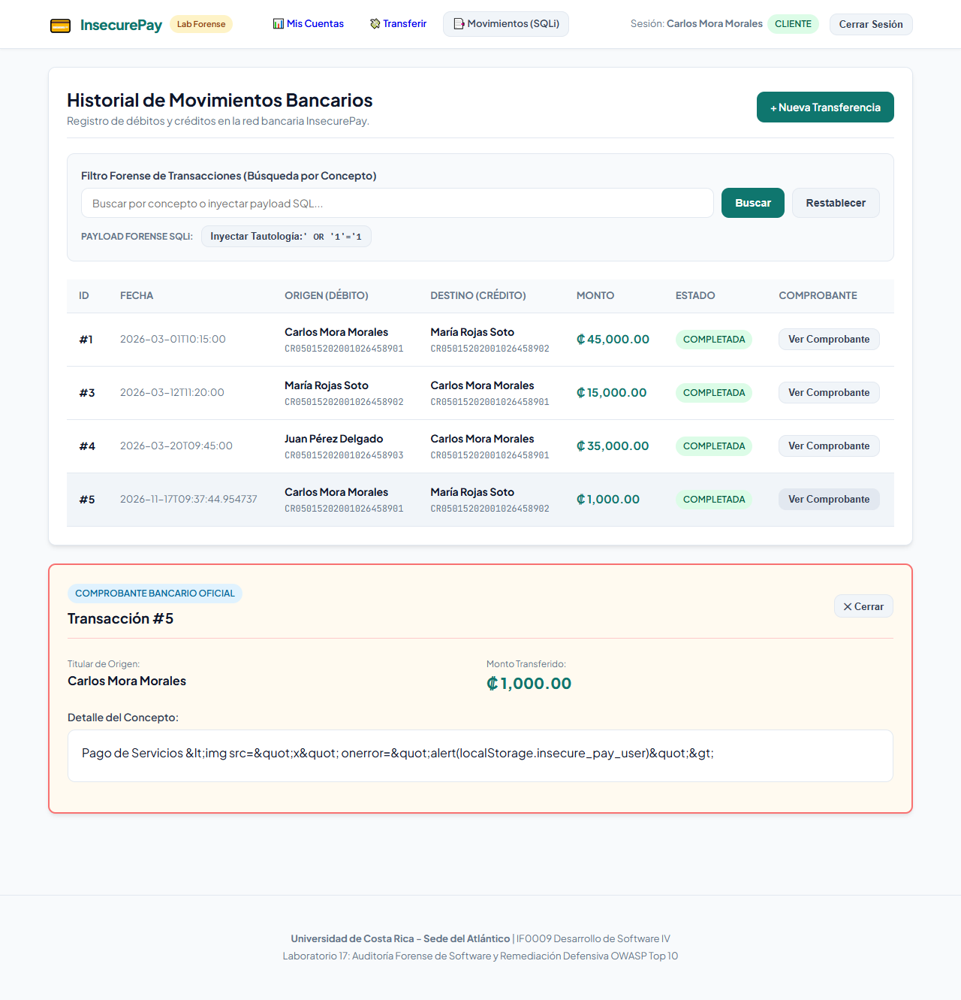

# Bitácora Pericial Forense — InsecurePay

**Curso:** IF0009 — Desarrollo de Software IV · Universidad de Costa Rica, Sede del Atlántico
**Laboratorio:** 17 — Auditoría Forense de Software, Detección OWASP Top 10 y Remediación Defensiva
**Fecha de la auditoría:** 17 de noviembre de 2026
**Objeto auditado:** InsecurePay (backend Spring Boot 3.3.4 / Java 21 + H2; frontend Angular 19)
**Versión vulnerable (línea base):** commit `ef19c14`
**Estándares de referencia:** OWASP Top 10:2021 · CWE · CVSS v3.1

---

## 1. Alcance y metodología

La auditoría siguió las seis fases del ciclo pericial del laboratorio:

| Fase | Actividad realizada | Artefacto |
|---|---|---|
| 1. Reconocimiento | Inventario de controladores REST, servicios, entidades JPA, configuración y componentes Angular. | Sección 2 |
| 2. SAST | Revisión manual del código fuente buscando concatenación SQL, secretos en claro, ausencia de controles de acceso y evasión del saneamiento de Angular. | Campo «Archivo y línea» de cada ficha |
| 3. DAST | Envío de payloads con `curl` contra la API y verificación en un navegador real (Chrome headless con Playwright). | `docs/poc/` |
| 4. PoC | Explotación controlada y no destructiva sobre la base H2 en memoria (se reinicia con cada arranque). | `docs/evidencias/antes/` |
| 5. Bitácora | Este documento. | — |
| 6. Remediación | Un commit por hallazgo, pruebas de regresión y nueva ejecución de las mismas PoC. | `docs/evidencias/despues/` |

**Cadena de custodia.** Las PoC son reproducibles con un único script, que guarda cada respuesta HTTP completa con su fecha y hora:

```bash
# Backend escuchando en :8080 (versión vulnerable o remediada)
bash docs/poc/ejecutar_poc.sh docs/evidencias/<antes|despues>

# Verificación en navegador (requiere también el frontend en :4200)
cd docs/poc/navegador && npm install && npm run xss && npm run idor
```

La evidencia del «antes» se obtuvo ejecutando el commit `ef19c14` en un *worktree* aislado. La del «después» se obtuvo con la versión remediada, arrancada con `JWT_SECRET` aleatorio. Los tokens que aparecen en las evidencias pertenecen a sesiones efímeras ya inválidas.

**Identidades de prueba.** `carlos_mora` (usuario 3) es dueño de la cuenta **ID 2** (`CR05015202001026458901`). `maria_rojas` (usuario 4) es dueña de la cuenta **ID 3** (`CR05015202001026458902`, saldo ₡4 850 000).

> **Nota sobre el enunciado.** El código entregado difiere del PDF en algunos datos: las contraseñas reales eran `carlos123`, `maria123`, `auditor2026`, `juan123` y `admin123`; Carlos solo tiene la cuenta ID 2; el saldo de María es ₡4 850 000; y el endpoint `GET /api/cuentas/{id}/saldo` no existía (respondía 404). Las PoC se ajustaron al código real, y el endpoint de saldo se implementó ya protegido.

---

## 2. Reconocimiento arquitectural

| Endpoint (versión original) | Autenticación | Control de propiedad | Vector |
|---|---|---|---|
| `POST /api/auth/login` | — | — | Contraseñas en claro; enumeración de usuarios |
| `GET /api/cuentas` | Ninguna | Ninguno | Listado global de cuentas y saldos |
| `GET /api/cuentas/{id}` | Ninguna | Ninguno | IDOR |
| `GET /api/cuentas/usuario/{usuarioId}` | Ninguna | Ninguno | BOLA |
| `GET /api/transacciones` y `/{id}` y `/cuenta/{id}` | Ninguna | Ninguno | Exposición de movimientos ajenos |
| `GET /api/transacciones/buscar` | Ninguna | Ninguno | SQL Injection |
| `POST /api/transacciones/transferir` | Ninguna | Ninguno | IDOR en débito + Stored XSS |

Hallazgo transversal: el backend **emitía** JWT pero **nunca los validaba**, y el frontend **no los enviaba** en ninguna petición. Toda la API era, en la práctica, anónima.

### Resumen de hallazgos

| ID | Vulnerabilidad | OWASP 2021 | CWE | CVSS v3.1 | Estado |
|---|---|---|---|---|---|
| HALLAZGO-01 | Inyección SQL en búsqueda de transacciones | A03 Injection | CWE-89 | **7.5 Alta** | Remediado |
| HALLAZGO-02 | IDOR/BOLA en cuentas, saldos y transferencias | A01 Broken Access Control | CWE-639 / CWE-862 | **9.1 Crítica** | Remediado |
| HALLAZGO-03 | Cross-Site Scripting almacenado en el comprobante | A03 Injection | CWE-79 | **7.6 Alta** | Remediado |
| HALLAZGO-04 | Contraseñas en texto plano y enumeración de usuarios | A02 Cryptographic Failures / A07 | CWE-256 / CWE-204 | **7.4 Alta** | Remediado |
| HALLAZGO-05 | Fuga de trazas técnicas y configuración insegura | A05 Security Misconfiguration | CWE-209 / CWE-798 | **5.3 Media** (+ ver 5.b) | Remediado |

---

## HALLAZGO-01 — Inyección SQL en búsqueda de transacciones

| Campo pericial | Especificación técnica |
|---|---|
| **Identificador** | HALLAZGO-01 |
| **Nombre** | Inyección SQL en `GET /api/transacciones/buscar` |
| **Clasificación OWASP** | A03:2021 — Injection (CWE-89) |
| **Severidad CVSS v3.1** | **7.5 Alta** — `CVSS:3.1/AV:N/AC:L/PR:N/UI:N/S:U/C:H/I:N/A:N` |
| **Archivo y línea afectada** | `backend/src/main/java/cr/ac/ucr/if0009/insecurepay/service/TransaccionService.java:54-61` (concatenación en las líneas 55-56; `createNativeQuery` en la línea 60) |
| **Descripción del vector** | El parámetro `termino` llega de la URL y se concatena dentro de una sentencia SQL nativa (`... LIKE '%" + termino + "%' ...`). Una comilla simple cierra el literal, y el resto del valor se interpreta como SQL. Además, la consulta se imprimía en la salida estándar. |
| **Prueba de concepto** | `curl -G http://localhost:8080/api/transacciones/buscar --data-urlencode "termino=' OR 1=1 --"` |
| **Impacto de negocio** | Cualquier persona, sin autenticarse, obtiene el historial completo de transacciones de todos los clientes (montos, titulares, números de cuenta). Con `UNION SELECT` es posible leer otras tablas, incluida `USUARIOS`, que tenía las contraseñas en claro (ver HALLAZGO-04). |
| **Estrategia de remediación** | Consulta JPQL declarativa con parámetro con nombre (`:termino`), que Hibernate vincula como parámetro del `PreparedStatement`. Además, se filtran los resultados por propiedad de la cuenta (defensa en profundidad). |

### Antes — explotación exitosa
Fuente: [`evidencias/antes/hallazgo01_sqli.txt`](evidencias/antes/hallazgo01_sqli.txt)

La sentencia resultante es `... WHERE concepto_html LIKE '%' OR 1=1 --%' OR estado ...`: la tautología vuelve verdadera la condición y `--` comenta el resto.

```text
### Payload tautologico (termino=' OR 1=1 --)
HTTP/1.1 200
[{"id":1,...,"titularOrigen":"Carlos Mora Morales",...},
 {"id":2,...,"titularOrigen":"María Rojas Soto","titularDestino":"Juan Pérez Delgado","monto":120000.00,...},
 {"id":3,...}, {"id":4,...}]          <- las 4 transacciones del banco
```

La misma ejecución confirma la fuga de la sentencia SQL en el error de HALLAZGO-05 (`termino='` → HTTP 500 con `SQL statement: SELECT * FROM TRANSACCIONES WHERE concepto_html LIKE '%'%' OR estado LIKE '%'%'`).

### Después — bloqueo confirmado
Fuente: [`evidencias/despues/hallazgo01_sqli.txt`](evidencias/despues/hallazgo01_sqli.txt)

```text
### Payload tautologico (termino=' OR 1=1 --)
HTTP/1.1 200
[]                                     <- se busca el texto literal "' OR 1=1 --"
```

### Parche aplicado
`backend/src/main/java/cr/ac/ucr/if0009/insecurepay/repository/TransaccionRepository.java`

```java
@Query("SELECT t FROM Transaccion t " +
       "WHERE LOWER(CAST(t.conceptoHtml AS String)) LIKE LOWER(CONCAT('%', :termino, '%')) " +
       "   OR LOWER(t.estado) LIKE LOWER(CONCAT('%', :termino, '%')) " +
       "ORDER BY t.fecha DESC")
List<Transaccion> buscarPorTerminoSeguro(@Param("termino") String termino);
```

`TransaccionService.java`

```java
public List<TransaccionDto> buscarPorConcepto(String termino, String authHeader) {
    Usuario usuario = sesionService.obtenerUsuarioAutenticado(authHeader);
    if (termino == null || termino.trim().isEmpty()) {
        return List.of();
    }
    return filtrarVisibles(transaccionRepository.buscarPorTerminoSeguro(termino.trim()).stream(), usuario);
}
```

**Justificación.** Con parámetros vinculados, el motor recibe el término como **dato** y nunca como parte de la gramática SQL, así que ningún carácter puede cambiar la semántica de la consulta. El `CAST(... AS String)` es necesario porque la columna es `@Lob` (CLOB) y Hibernate 6 no admite `LOWER()` sobre CLOB; durante la remediación este error impedía arrancar el contexto y se corrigió en el commit `711afe3`. La búsqueda también exige un JWT válido y solo devuelve movimientos en los que participa una cuenta del usuario.

---

## HALLAZGO-02 — IDOR / BOLA en cuentas, saldos y transferencias

| Campo pericial | Especificación técnica |
|---|---|
| **Identificador** | HALLAZGO-02 |
| **Nombre** | Referencia directa insegura a objetos en consulta de cuentas y débito de transferencias |
| **Clasificación OWASP** | A01:2021 — Broken Access Control (CWE-639 Authorization Bypass Through User-Controlled Key; CWE-862 Missing Authorization) |
| **Severidad CVSS v3.1** | **9.1 Crítica** — `CVSS:3.1/AV:N/AC:L/PR:N/UI:N/S:U/C:H/I:H/A:N` |
| **Archivo y línea afectada** | `controller/CuentaController.java:22-39` · `service/CuentaService.java:30-34` · `service/TransaccionService.java:71-78` (`findById(dto.getCuentaOrigenId())` sin verificar al dueño) · `dto/TransferenciaDto.java:8` · `frontend/.../transferir.component.ts:18` |
| **Descripción del vector** | Los identificadores (`{id}`, `{usuarioId}`, `cuentaOrigenId`) vienen del cliente y se usan directamente en `findById`. No existía ningún filtro ni validación del JWT, así que el backend no sabía quién hacía la solicitud y nunca comparaba al dueño del recurso. |
| **Prueba de concepto** | `curl http://localhost:8080/api/cuentas/3 -H "Authorization: Bearer <TOKEN_CARLOS>"` y `curl -X POST .../api/transacciones/transferir -d '{"cuentaOrigenId":3,"numeroCuentaDestino":"CR05015202001026458901","monto":100000,...}'` |
| **Impacto de negocio** | **Confidencialidad:** cualquier persona enumera saldos, titulares y números de cuenta de todos los clientes (incluso sin token). **Integridad financiera:** Carlos debitó ₡100 000 de la cuenta de María y los acreditó en la suya. Es fraude directo y una violación de la confidencialidad bancaria. |
| **Estrategia de remediación** | La identidad se toma **solo** del claim `sub` del JWT firmado (`SesionService`). Cada operación compara al dueño del recurso con esa identidad: 401 sin token o con token inválido, 403 ante un recurso ajeno. Para transferencias, ni ADMIN ni AUDITOR pueden debitar cuentas ajenas. |

### Antes — explotación exitosa
Fuente: [`evidencias/antes/hallazgo02_idor.txt`](evidencias/antes/hallazgo02_idor.txt)

```text
### Consulta de cuenta ajena (ID 3) con token de Carlos
HTTP/1.1 200
{"id":3,"usuarioId":4,"titular":"María Rojas Soto","numeroCuenta":"CR05015202001026458902",
 "tipoCuenta":"CORRIENTE","saldo":4850000.00,"moneda":"CRC","activa":true}

### Consulta sin token (ID 3)
HTTP/1.1 200                              <- ni siquiera hace falta autenticarse
{"id":3,"usuarioId":4,"titular":"María Rojas Soto",...,"saldo":4850000.00,...}

### Transferencia DESDE la cuenta de Maria (ID 3) HACIA la cuenta de Carlos
HTTP/1.1 201
{"id":5,"cuentaOrigenId":3,"titularOrigen":"María Rojas Soto",
 "cuentaDestinoId":2,"titularDestino":"Carlos Mora Morales","monto":100000,
 "conceptoHtml":"Retiro no autorizado","estado":"COMPLETADA"}
```

Evidencia en navegador: el panel del dashboard muestra a Carlos el saldo y el titular de la cuenta 3.



### Después — bloqueo confirmado
Fuente: [`evidencias/despues/hallazgo02_idor.txt`](evidencias/despues/hallazgo02_idor.txt)

```text
### Consulta de cuenta ajena (ID 3) con token de Carlos
HTTP/1.1 403
{"type":".../errores/acceso-denegado","title":"Acceso denegado","status":403,
 "detail":"Acceso no autorizado a cuenta ajena.","instance":"/api/cuentas/3"}

### Consulta de saldo ajeno (ID 3) con token de Carlos
HTTP/1.1 403   {"detail":"Acceso no autorizado a cuenta ajena.","instance":"/api/cuentas/3/saldo",...}

### Consulta sin token (ID 3)
HTTP/1.1 401   {"title":"No autenticado","detail":"Cabecera de autorizacion ausente o invalida.",...}

### Transferencia DESDE la cuenta de Maria (ID 3) HACIA la cuenta de Carlos
HTTP/1.1 403   {"detail":"Fraude detectado: no puede debitar fondos de cuentas ajenas.",...}
```

Matriz completa verificada durante la remediación:

| Solicitud | Antes | Después |
|---|---|---|
| Carlos → `GET /api/cuentas/2` (propia) | 200 | **200** |
| Carlos → `GET /api/cuentas/3` (ajena) | 200 | **403** |
| Carlos → `GET /api/cuentas/3/saldo` | 404 (no existía) | **403** |
| Sin token → `GET /api/cuentas/3` | 200 | **401** |
| Token alterado → `GET /api/cuentas/2` | 200 | **401** |
| Carlos → `GET /api/cuentas` (listado global) | 200 | **403** |
| Carlos → `GET /api/cuentas/usuario/4` | 200 | **403** |
| Auditor → `GET /api/cuentas/3` | 200 | **200** (rol de auditoría) |
| Carlos → transferir desde la cuenta 3 | 201 | **403** |
| Carlos → transferir desde la cuenta 2 | 201 | **201** |



### Parche aplicado
`service/SesionService.java` (nuevo): la identidad se deriva del token firmado.

```java
public Usuario obtenerUsuarioAutenticado(String authHeader) {
    String token = extraerToken(authHeader);            // exige "Bearer <jwt>" -> 401
    String username;
    try {
        username = jwtUtil.extraerUsername(token);       // verifica firma HS256 y expiración
    } catch (JwtException | IllegalArgumentException e) {
        throw new NoAutenticadoException("Token de acceso invalido o expirado.");
    }
    return usuarioRepository.findByUsername(username)
            .orElseThrow(() -> new NoAutenticadoException("Token de acceso invalido o expirado."));
}
```

`service/CuentaService.java`

```java
public CuentaDto obtenerCuentaSegura(Long cuentaId, String authHeader) {
    Usuario usuario = sesionService.obtenerUsuarioAutenticado(authHeader);
    CuentaBancaria cuenta = cuentaRepository.findById(cuentaId)
            .orElseThrow(() -> new RecursoNoEncontradoException("Cuenta bancaria no existe."));
    if (!sesionService.esPropietario(usuario, cuenta) && !sesionService.esPrivilegiado(usuario)) {
        throw new AccesoDenegadoException("Acceso no autorizado a cuenta ajena.");   // 403
    }
    return convertirADto(cuenta);
}
```

`service/TransaccionService.java` (antes de debitar)

```java
// Validar que la cuenta de origen pertenece al usuario autenticado
if (!sesionService.esPropietario(usuario, cuentaOrigen)) {
    throw new AccesoDenegadoException("Fraude detectado: no puede debitar fondos de cuentas ajenas.");
}
```

Frontend: `services/auth.interceptor.ts` adjunta `Authorization: Bearer <token>` a cada petición hacia la API, y `transferir.component.ts` solo ofrece las cuentas propias como origen.

**Justificación.** El control de acceso se aplica **en el servidor y por objeto**, no en la interfaz. El rol se toma de la base de datos (`Rol.ADMIN`/`Rol.AUDITOR`) y no de *usernames* fijos en el código, como proponía el PDF, para que el control no dependa de nombres. Los listados (`/api/transacciones`, búsqueda) también filtran por propiedad, porque un endpoint de colección expone lo mismo que uno de detalle.

---

## HALLAZGO-03 — Cross-Site Scripting almacenado en el comprobante

| Campo pericial | Especificación técnica |
|---|---|
| **Identificador** | HALLAZGO-03 |
| **Nombre** | Stored XSS en el concepto de la transferencia, renderizado en «Ver comprobante» |
| **Clasificación OWASP** | A03:2021 — Injection (CWE-79) |
| **Severidad CVSS v3.1** | **7.6 Alta** — `CVSS:3.1/AV:N/AC:L/PR:L/UI:R/S:C/C:H/I:L/A:N` |
| **Archivo y línea afectada** | Fuente: `service/TransaccionService.java:98` (`setConceptoHtml(dto.getConceptoHtml())`). Sumidero: `frontend/src/app/components/transacciones/transacciones.component.ts:82` (`bypassSecurityTrustHtml`) y `transacciones.component.html:101` (`[innerHTML]`) |
| **Descripción del vector** | El concepto se guarda tal cual en `CONCEPTO_HTML`. Al abrir el comprobante, el componente desactiva explícitamente el `DomSanitizer` de Angular y lo inserta como HTML, así que los atributos de evento (`onerror`) se ejecutan en el navegador de quien lo visualiza. El alcance cambia (S:C) porque el código corre en la sesión de la víctima. |
| **Prueba de concepto** | Transferencia con concepto `Pago de Servicios ` y luego **Movimientos → Ver comprobante**. |
| **Impacto de negocio** | Robo del JWT y de los datos de sesión almacenados en `localStorage`, lo que permite secuestrar la cuenta de la víctima (por ejemplo, María al revisar el comprobante que recibió) y hacer transferencias en su nombre. |
| **Estrategia de remediación** | Se elimina el *bypass* y se usa la interpolación `{{ }}` (codificación de salida). Como defensa en profundidad, el backend codifica `& < > " '` antes de persistir. |

### Antes — explotación exitosa
Fuentes: [`antes/hallazgo03_xss.txt`](evidencias/antes/hallazgo03_xss.txt) y [`antes/hallazgo03_xss_navegador.txt`](evidencias/antes/hallazgo03_xss_navegador.txt)

```text
HTTP/1.1 201
{"id":6,...,"conceptoHtml":"Pago de Servicios ",...}

# Verificacion en navegador (Google Chrome headless + Playwright)
3. innerHTML del contenedor del concepto: Pago de Servicios 
4. Elementos  inyectados en el comprobante: 1
5. RESULTADO: JavaScript EJECUTADO. alert() mostro: {"token":"eyJhbGciOiJIUzI1NiJ9.eyJzdWIiOiJjYXJsb3NfbW9yYSIs...",
   "username":"carlos_mora","nombreCompleto":"Carlos Mora Morales","rol":"CLIENTE","usuarioId":3}
```



### Después — bloqueo confirmado
Fuentes: [`despues/hallazgo03_xss.txt`](evidencias/despues/hallazgo03_xss.txt) y [`despues/hallazgo03_xss_navegador.txt`](evidencias/despues/hallazgo03_xss_navegador.txt)

```text
HTTP/1.1 201
{...,"conceptoHtml":"Pago de Servicios &lt;img src=&quot;x&quot; onerror=&quot;alert(localStorage.insecure_pay_user)&quot;&gt;",...}

4. Elementos  inyectados en el comprobante: 0
5. RESULTADO: ningun alert() se ejecuto; el payload se muestra como texto plano.
```



### Parche aplicado
`transacciones.component.html` (sumidero eliminado)

```html
<!-- REMEDIACION XSS: interpolacion {{ }} -> Angular codifica < > " & como texto plano -->
<div class="comprobante-concepto" ...>{{ transaccionSeleccionada.conceptoHtml }}</div>
```

`transacciones.component.ts`: se eliminan `DomSanitizer`, `SafeHtml` y la llamada a `bypassSecurityTrustHtml`.

`TransaccionService.java` (defensa en profundidad)

```java
static String sanitizarTexto(String entrada) {
    if (entrada == null) return "";
    return entrada
            .replace("&", "&amp;")      // primero, para no recodificar las entidades generadas
            .replace("<", "&lt;")
            .replace(">", "&gt;")
            .replace("\"", "&quot;")
            .replace("'", "&#x27;");
}
...
transaccion.setConceptoHtml(sanitizarTexto(dto.getConceptoHtml()));
```

**Justificación.** El control principal es la **codificación de salida en el contexto correcto**: la interpolación de Angular asigna `textContent`, nunca `innerHTML`, así que ningún dato se interpreta como marcado. La codificación en el backend protege a otros consumidores de la API (reportes, apps móviles) que podrían renderizar el campo sin cuidado. Como contrapartida, si un texto lleva caracteres especiales, el comprobante muestra las entidades (`&lt;`) literalmente; se acepta porque el concepto no necesita formato enriquecido. Los datos semilla se convirtieron a texto plano.

---

## HALLAZGO-04 — Contraseñas en texto plano y enumeración de usuarios

| Campo pericial | Especificación técnica |
|---|---|
| **Identificador** | HALLAZGO-04 |
| **Nombre** | Almacenamiento y validación de credenciales en texto plano |
| **Clasificación OWASP** | A02:2021 — Cryptographic Failures (CWE-256, CWE-916) y A07:2021 — Identification and Authentication Failures (CWE-204) |
| **Severidad CVSS v3.1** | **7.4 Alta** — `CVSS:3.1/AV:N/AC:H/PR:N/UI:N/S:U/C:H/I:H/A:N` (AC:H porque leer la tabla exige un segundo vector: la SQLi de HALLAZGO-01 o la consola H2 de HALLAZGO-05) |
| **Archivo y línea afectada** | `backend/src/main/resources/data.sql:6-11` · `service/AuthService.java:27` (`equals`) y `:25` (mensaje distinto para usuario inexistente) · `model/Usuario.java:18-19` · `frontend/.../login.component.html:34-44` (contraseñas en el bundle) |
| **Descripción del vector** | Las contraseñas se guardaban y comparaban en claro (`usuario.getPassword().equals(...)`). Cualquier lectura de la tabla `USUARIOS` (SQLi, consola H2, respaldo o log) revela las credenciales reales. Además, los mensajes de error distinguían «usuario no encontrado» de «credenciales inválidas», y los botones de acceso rápido del login incluían las contraseñas en el JavaScript publicado. |
| **Prueba de concepto** | Lectura de `data.sql` y del endpoint de login con un usuario inexistente frente a una contraseña incorrecta (respuestas diferenciables). |
| **Impacto de negocio** | Toma de control inmediata de todas las cuentas (incluida `admin`) y reutilización de las contraseñas en otros servicios de los clientes. La enumeración facilita ataques de fuerza bruta dirigidos. |
| **Estrategia de remediación** | `BCryptPasswordEncoder` con factor de trabajo 12, hashes `$2a$12$` en `data.sql`, validación exclusivamente con `passwordEncoder.matches()`, respuesta 401 idéntica para cualquier fallo y comparación contra un hash señuelo cuando el usuario no existe (respuesta de duración similar). |

### Antes — explotación exitosa
Fuente: [`evidencias/antes/hallazgo04_credenciales.txt`](evidencias/antes/hallazgo04_credenciales.txt)

```text
6:INSERT INTO USUARIOS (username, password, nombre_completo, email, rol) VALUES
7-('admin', 'admin123', ...
9-('carlos_mora', 'carlos123', ...
10-('maria_rojas', 'maria123', ...

### Login con contrasena incorrecta
HTTP/1.1 500   {"trace":"java.lang.RuntimeException: Credenciales invalidas para el usuario: carlos_mora ..."}

### Login con usuario inexistente (enumeracion)
HTTP/1.1 500   {"trace":"java.lang.RuntimeException: Usuario no encontrado en InsecurePay: no_existe ..."}
```

### Después — bloqueo confirmado
Fuente: [`evidencias/despues/hallazgo04_credenciales.txt`](evidencias/despues/hallazgo04_credenciales.txt)

```text
8-('admin', '$2a$12$Q28.EcKoIqkdez9fiv/mlO191R7VtliwOyV9PCtb9pMtQZvNHFDUa', ...
10-('carlos_mora', '$2a$12$G3tR6CUiTr08OWS5iXFipOLtQJthh10um6OnLGp39Db5PNi8PTcYK', ...

### Login valido (carlos_mora)
HTTP/1.1 200   {"token":"eyJhbGciOiJIUzI1NiJ9...","username":"carlos_mora",...}

### Login con contrasena incorrecta
HTTP/1.1 401   {"title":"Credenciales invalidas","detail":"Usuario o contrasena incorrectos.",...}

### Login con usuario inexistente (enumeracion)
HTTP/1.1 401   {"title":"Credenciales invalidas","detail":"Usuario o contrasena incorrectos.",...}
```

Los cinco usuarios de prueba (`admin`, `auditor_seguridad`, `carlos_mora`, `maria_rojas`, `juan_perez`) se autenticaron correctamente con BCrypt.

### Parche aplicado
`config/SecurityConfig.java`

```java
@Configuration
public class SecurityConfig {
    public static final int BCRYPT_STRENGTH = 12;   // 2^12 rondas (mínimo exigido: 10)

    @Bean
    public PasswordEncoder passwordEncoder() {
        return new BCryptPasswordEncoder(BCRYPT_STRENGTH);
    }
}
```

`service/AuthService.java`

```java
Optional<Usuario> encontrado = usuarioRepository.findByUsername(request.getUsername());
String hashAlmacenado = encontrado.map(Usuario::getPassword).orElse(hashSenuelo);

boolean coincide = passwordEncoder.matches(request.getPassword(), hashAlmacenado);
if (encontrado.isEmpty() || !coincide) {
    throw new CredencialesInvalidasException();    // 401 "Usuario o contrasena incorrectos."
}
```

**Justificación.** BCrypt aplica una sal aleatoria por usuario (dos usuarios con la misma clave tienen hashes distintos) y un costo adaptativo que vuelve muy caros los ataques de diccionario fuera de línea. Se agregó solo `spring-security-crypto` y no el *starter* completo de Spring Security, que habría activado autenticación HTTP Basic en todos los endpoints. Los hashes se generaron con la misma biblioteca y se verificaron con `matches()` antes de guardarlos. Las contraseñas tampoco se registran en logs ni aparecen en ninguna respuesta.

**Riesgo residual.** En el entorno local de laboratorio, el login viaja por `http://`. En producción, el transporte debe ir con TLS (HTTPS y HSTS) para que la contraseña no viaje en claro por la red.

---

## HALLAZGO-05 — Fuga de trazas técnicas y configuración insegura

| Campo pericial | Especificación técnica |
|---|---|
| **Identificador** | HALLAZGO-05 |
| **Nombre** | Exposición de *stack traces*, sentencias SQL y configuración sensible |
| **Clasificación OWASP** | A05:2021 — Security Misconfiguration (CWE-209, CWE-215) y A02:2021 (CWE-798 secreto en el código) |
| **Severidad CVSS v3.1** | **5.3 Media** — `CVSS:3.1/AV:N/AC:L/PR:N/UI:N/S:U/C:L/I:N/A:N` (fuga de trazas). Ver los subhallazgos 5.b. |
| **Archivo y línea afectada** | `backend/src/main/resources/application.properties:28-30` (`include-message/stacktrace/binding-errors=always`), `:15-17` (consola H2 con `web-allow-others=true`), `:34` (`jwt.secret` en el repositorio) · `frontend/.../transacciones.component.ts:67` (mostraba `err.error.trace` en pantalla) · `config/CorsConfig.java:15` (`allowedOrigins("*")`) |
| **Descripción del vector** | Ante cualquier excepción, Spring devolvía la traza completa: paquetes, clases, números de línea, versión de Hibernate y la sentencia SQL. Esto le da a un atacante un mapa interno para afinar inyecciones. |
| **Prueba de concepto** | `curl -G .../api/transacciones/buscar --data-urlencode "termino='"` y `curl .../api/cuentas/999` |
| **Impacto de negocio** | Reconocimiento acelerado (tecnologías, esquema y consultas), que reduce el esfuerzo para explotar los demás hallazgos. |
| **Estrategia de remediación** | `include-*=never`, `@RestControllerAdvice` con respuestas RFC 7807 (`ProblemDetail`), detalle técnico solo en el log del servidor con un id de incidente, consola H2 deshabilitada, secreto JWT por variable de entorno con un mínimo de 256 bits y CORS restringido. |

### 5.b Subhallazgos de configuración

| Sub-ID | Hallazgo | CWE | CVSS v3.1 | Estado |
|---|---|---|---|---|
| 05-A | Trazas y mensajes internos en respuestas HTTP | CWE-209 | 5.3 Media `AV:N/AC:L/PR:N/UI:N/S:U/C:L/I:N/A:N` | Remediado |
| 05-B | Consola H2 accesible desde la red, usuario `sa` sin contraseña (HTTP 200 en `/h2-console/`). Permite SQL arbitrario sobre la BD; **no se explotó**, se evaluó solo por configuración. | CWE-306 / CWE-1188 | 9.8 Crítica `AV:N/AC:L/PR:N/UI:N/S:U/C:H/I:H/A:H` | Remediado (404) |
| 05-C | Secreto JWT predecible y versionado en el repositorio (`ClaveSecretaSuperDebilInsecurePayBanco2026`): con él se pueden falsificar tokens de cualquier usuario. | CWE-798 / CWE-321 | 7.5 Alta `AV:N/AC:L/PR:N/UI:N/S:U/C:N/I:H/A:N` | Remediado |
| 05-D | CORS con comodín `*` en toda la API | CWE-942 | 5.3 Media | Remediado |

### Antes — explotación exitosa
Fuente: [`evidencias/antes/hallazgo05_fuga_trazas.txt`](evidencias/antes/hallazgo05_fuga_trazas.txt)

```text
### Error de sintaxis SQL provocado (termino=')
HTTP/1.1 500
{"status":500,"error":"Internal Server Error",
 "trace":"org.hibernate.exception.DataException: could not prepare statement [Valor Invalido ... SQL statement:
          SELECT * FROM TRANSACCIONES WHERE concepto_html LIKE '%'%' OR estado LIKE '%'%' [90008-224]] ..."}

### Recurso inexistente (cuenta 999)
HTTP/1.1 500   {"trace":"java.lang.RuntimeException: Cuenta bancaria no encontrada con ID: 999
                at cr.ac.ucr.if0009.insecurepay.service.CuentaService.lambda$obtenerPorId$0(CuentaService.java:32) ..."}

### Consola H2 expuesta
HTTP 200

### Secreto JWT en el repositorio
34:jwt.secret=ClaveSecretaSuperDebilInsecurePayBanco2026
```

### Después — bloqueo confirmado
Fuente: [`evidencias/despues/hallazgo05_fuga_trazas.txt`](evidencias/despues/hallazgo05_fuga_trazas.txt)

```text
### Error de sintaxis SQL provocado (termino=')
HTTP/1.1 200
[]                                          <- la comilla ya no rompe la consulta

### Recurso inexistente (cuenta 999)
HTTP/1.1 404
Content-Type: application/problem+json
{"type":"https://insecurepay.fi.cr/errores/recurso-no-encontrado","title":"Recurso no encontrado",
 "status":404,"detail":"Cuenta bancaria no existe.","instance":"/api/cuentas/999","timestamp":"..."}

### Consola H2 expuesta
HTTP 404

### Secreto JWT en el repositorio
39:jwt.secret=${JWT_SECRET:}
```

Otras respuestas verificadas: JSON malformado → `400 {"title":"Bad Request","detail":"Failed to read request"}`; ruta inexistente → `404` en ProblemDetail; monto negativo → `400 "El monto a transferir debe ser mayor a cero."`; preflight CORS desde `http://evil.com` → `403`, y desde `http://localhost:4200` → `200`.

### Parche aplicado
`application.properties`

```properties
server.error.include-stacktrace=never
server.error.include-message=never
server.error.include-binding-errors=never
server.error.include-exception=false
spring.mvc.problemdetails.enabled=true

spring.h2.console.enabled=${H2_CONSOLE_ENABLED:false}
spring.h2.console.settings.web-allow-others=false
spring.jpa.show-sql=false

jwt.secret=${JWT_SECRET:}
jwt.expiration-ms=${JWT_EXPIRATION_MS:3600000}
app.cors.allowed-origins=${CORS_ALLOWED_ORIGINS:http://localhost:4200}
```

`exception/GlobalExceptionHandler.java` (extracto)

```java
@RestControllerAdvice
public class GlobalExceptionHandler extends ResponseEntityExceptionHandler {

    @ExceptionHandler(AccesoDenegadoException.class)
    public ProblemDetail accesoDenegado(AccesoDenegadoException ex, HttpServletRequest req) {
        return problema(HttpStatus.FORBIDDEN, "acceso-denegado", "Acceso denegado", ex.getMessage(), req);
    }

    @ExceptionHandler({DataAccessException.class, Exception.class})   // (dos manejadores en el código)
    public ProblemDetail errorGenerico(Exception ex, HttpServletRequest req) {
        String incidente = UUID.randomUUID().toString();
        log.error("Incidente {} en {} {}", incidente, req.getMethod(), req.getRequestURI(), ex); // solo en el log
        ProblemDetail pd = problema(HttpStatus.INTERNAL_SERVER_ERROR, "error-interno", "Error interno",
                "Ocurrio un error inesperado. Contacte a soporte indicando el identificador del incidente.", req);
        pd.setProperty("incidente", incidente);
        return pd;
    }
}
```

`util/JwtUtil.java`

```java
@PostConstruct
void inicializarClave() {
    if (secret == null || secret.isBlank()) {                  // sin JWT_SECRET: clave aleatoria efímera
        byte[] aleatoria = new byte[64];
        new SecureRandom().nextBytes(aleatoria);
        signingKey = Keys.hmacShaKeyFor(aleatoria);
        log.warn("JWT_SECRET no definida: se genero una clave HMAC aleatoria efimera...");
        return;
    }
    byte[] bytes = secret.getBytes(StandardCharsets.UTF_8);
    if (bytes.length < LONGITUD_MINIMA_BYTES) {                // 32 bytes = 256 bits
        throw new IllegalStateException("JWT_SECRET debe tener al menos 256 bits (32 bytes) para HMAC-SHA256.");
    }
    signingKey = Keys.hmacShaKeyFor(bytes);
}
```

**Justificación.** RFC 7807 da a los clientes un contrato de error uniforme (`type`, `title`, `status`, `detail`, `instance`) sin exponer detalles de implementación. Los mensajes de `detail` están redactados por el equipo y nunca provienen de excepciones de terceros. Para errores 500, el id de incidente permite correlacionar el reporte del usuario con el log sin revelar nada. En cuanto al secreto JWT: si se omite, el sistema **falla de forma segura** (genera una clave aleatoria en lugar de usar una predecible), y si se configura con menos de 256 bits, la aplicación no arranca. La plantilla de variables está en `backend/.env.example`, y `.env` quedó excluido del control de versiones.

---

## 3. Verificación final (checklist de entrega)

| Ítem del checklist | Resultado | Evidencia |
|---|---|---|
| Backend compila sin errores (`mvn clean test`) | ✅ 10 pruebas, 0 fallos | `SeguridadRegresionTests` (9) + `InsecurePayApplicationTests` (1) |
| Búsqueda con JPQL parametrizado, invulnerable a `' OR 1=1 --` | ✅ | HALLAZGO-01 |
| Cuentas y transferencias bloquean IDOR con HTTP 403 | ✅ | HALLAZGO-02 |
| El concepto no ejecuta scripts en el comprobante | ✅ | HALLAZGO-03 (navegador real) |
| Contraseñas con BCrypt en `data.sql` y login funcional | ✅ | HALLAZGO-04 |
| Sin trazas ni detalles internos ante errores | ✅ | HALLAZGO-05 |
| Bitácora con los 5 hallazgos | ✅ | Este documento |

Las pruebas de regresión (`backend/src/test/java/.../SeguridadRegresionTests.java`) reproducen cada PoC y fallarían si alguna vulnerabilidad se reintrodujera.

## 4. Trazabilidad de commits

| Commit | Descripción |
|---|---|
| `6824363` | Script de PoC y evidencias del «antes» |
| `083abe3` | HALLAZGO-01: JPQL parametrizado |
| `711afe3` | fix: `CAST` de CLOB en la consulta JPQL (el contexto no arrancaba) |
| `9e953c3` | HALLAZGO-02: control de propiedad con identidad JWT + interceptor Angular |
| `8c7d72d` | HALLAZGO-03: eliminación del *bypass* + codificación en backend |
| `e76fd61` | HALLAZGO-04 / Reto 4.1: BCrypt |
| `484b35f` | HALLAZGO-05 / Reto 4.2: hardening y RFC 7807 |
| `d468c87` | Pruebas de regresión de seguridad |
| `7a47297` | fix: payload del PoC XSS + evidencias del «después» y del navegador |

## 5. Recomendaciones fuera de alcance

1. Migrar la validación del JWT a un filtro de Spring Security (`SecurityFilterChain` + `oauth2-resource-server`) para que ningún endpoint nuevo quede desprotegido por omisión.
2. Guardar el token en una cookie `HttpOnly; Secure; SameSite=Strict` en lugar de `localStorage`, para que una XSS futura no pueda leerlo.
3. Agregar una cabecera `Content-Security-Policy` sin `unsafe-inline` como segunda barrera contra XSS.
4. Limitar la tasa de intentos de login (*rate limiting*) y bloquear cuentas temporalmente ante fuerza bruta.
5. Registrar en una bitácora de auditoría inmutable los intentos 403 sobre cuentas ajenas, que hoy solo quedan en el log como `WARN`.
